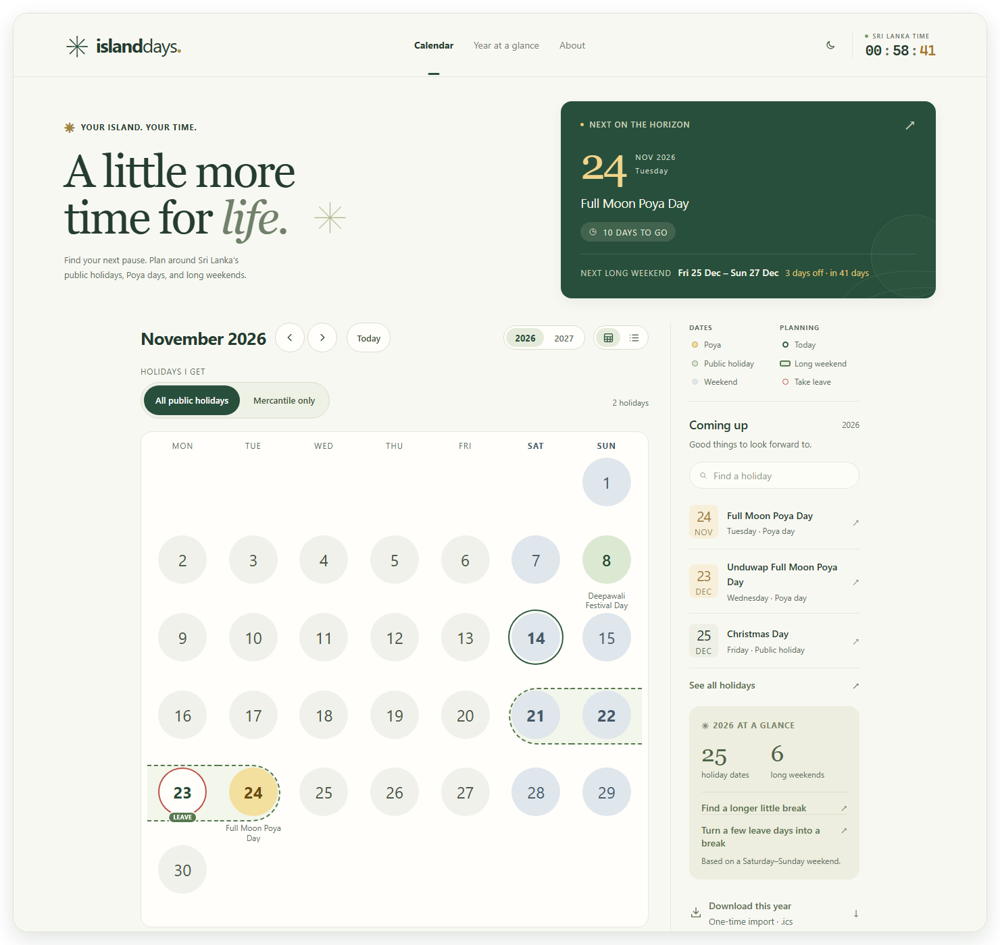

  

  <h1>Island Days</h1>
  
<strong>A little more time for life.</strong>

  
A thoughtfully designed public holiday calendar for Sri Lanka. Find your next pause, explore Poya days, and make room for a longer break.

  
<a href="https://dayoff.itsnooblk.com/"><strong>Explore the live calendar ↗</strong></a>

  
  
  
  

## Overview

Island Days brings Sri Lanka’s public holidays into a calm, easy-to-explore calendar. A warm green-and-cream palette, clear date highlights, and responsive layouts make it useful whether you are planning the year ahead or looking for your next day off.

The project is maintained by [nooblk-98](https://github.com/nooblk-98), with holiday dates from the [Central Bank of Sri Lanka](https://www.cbsl.gov.lk/en/about/about-the-bank/bank-holidays-2026) holiday list, which follows the gazette issued under the Holidays Act No. 29 of 1971.

## Features

- **Month, year, and list views**: browse one month, see the year at a glance, or search the full holiday list.
- **Simple holiday choices**: switch between all public holidays and Mercantile only, which includes every Poya day. Poya dates keep their distinct calendar highlights.
- **Upcoming holidays**: a next-holiday countdown and a short list of dates to look forward to.
- **Bank and mercantile holidays**: each holiday shows whether it is also a bank or mercantile (private-sector) holiday, using the official codes from the Central Bank's list, with a Mercantile filter.
- **Long weekends and leave breaks**: the calendar bands breaks of three days or more, solid when no leave is needed and dashed when one to five leave days would join a holiday to the weekend.
- **Personal break planning**: the calendar remembers your holiday choice. In the leave planner, choose a Monday–Friday or Monday–Saturday week and how many leave days you can take.
- **Leave planner**: the best-value leave ideas for the year, each downloadable as a calendar event that blocks the whole break.
- **Shareable links**: the address keeps the month, view, filter and open holiday, so any view can be bookmarked or sent.
- **Light and dark themes**: follows your system setting, with a toggle in the header.
- **Sri Lanka time, live**: a digital header clock shows local time in Asia/Colombo, including seconds, wherever you are browsing from.
- **Public visit count**: a shared total in the footer counts visits to the calendar and yearly holiday pages, including repeat visits, from the counter's launch date. It stores only the total and start date, with no visitor identifiers.
- **Live calendar subscriptions**: subscribe to [`/holidays.ics`](https://dayoff.itsnooblk.com/holidays.ics) or [`/holidays-mercantile.ics`](https://dayoff.itsnooblk.com/holidays-mercantile.ics) in Apple Calendar, Outlook or Google Calendar and receive updates automatically.
- **Calendar downloads**: export a single holiday or a full year as a one-time `.ics` import.
- **Search-friendly**: a crawlable page per year ([2026](https://dayoff.itsnooblk.com/sri-lanka-holidays-2026/), [2027](https://dayoff.itsnooblk.com/sri-lanka-holidays-2027/)) with a full holiday table, keyword-rich titles and descriptions, WebSite, WebApplication, Dataset and breadcrumb structured data, `robots.txt` and `sitemap.xml`, and a 1200×630 link preview (`npm run og`; `npm run banner` retakes this README screenshot while `npm run dev` is running). Set the `GOOGLE_SITE_VERIFICATION` or `BING_SITE_VERIFICATION` repository variable to add a search console verification tag, and `SITE_URL` when building for another domain.
- **Transparent data status**: last-checked dates, source links, and overdue-update notices.
- **Responsive and accessible**: phone-friendly layouts, keyboard focus, accessible dialogs, reduced-motion support, and print styling.

## Maintained, with care

Every push to `main` builds, checks, and deploys the calendar to Cloudflare Pages. A monthly GitHub Actions run reads the Central Bank's list for the current year and the next two, validates every date and weekday, and publishes the result; the same refresh can be run manually. A year appears as soon as the bank publishes its gazetted list, usually around the middle of the previous year. The current year is required; failed refreshes leave the current live calendar available, and past years remain available as the source rolls forward.

Dates use **Asia/Colombo**, independently of the visitor’s browser timezone. Poya days are public holidays and are highlighted separately. Year totals count distinct dates, including days with more than one holiday.

## Built with

**HTML · CSS · Vanilla JavaScript · Node.js · Cheerio · GitHub Actions · Cloudflare Pages**

A static calendar with no frontend framework, visitor accounts, cookies, or external fonts. A small Cloudflare Pages Function and D1 database maintain the public visit total. Local previews use a separate SQLite counter. Cookie-free [Cloudflare Web Analytics](https://www.cloudflare.com/web-analytics/) remains available for site analytics.

> [!NOTE]
> The government can declare or move holidays after the gazette, and the calendar picks up changes when the Central Bank updates its list. Verify dates and working arrangements before booking. Downloads are one-time imports; use a subscription to receive changes.
