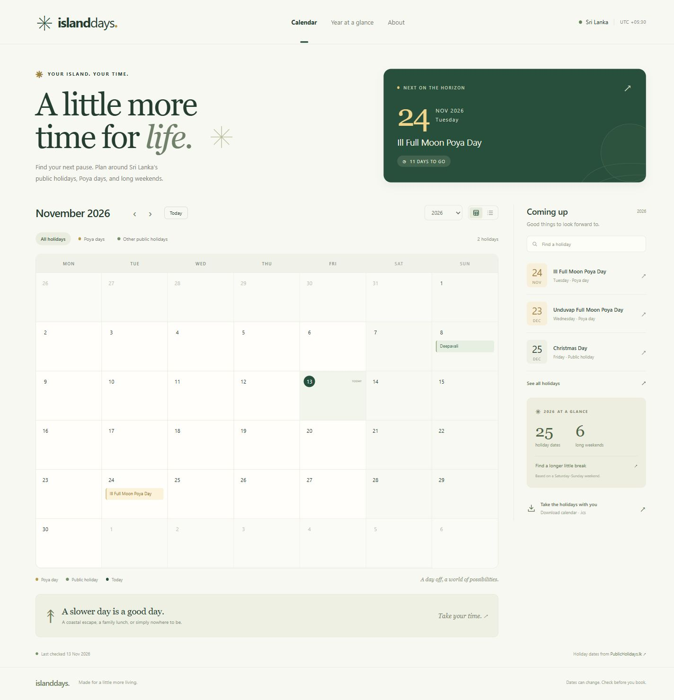

  

  <h1>Island Days</h1>
  
<strong>A little more time for life.</strong>

  
A thoughtfully designed public holiday calendar for Sri Lanka. Find your next pause, explore Poya days, and make room for a longer break.

  
<a href="https://island-days.pages.dev/"><strong>Explore the live calendar ↗</strong></a>

  
  
  
  

## Overview

Island Days brings Sri Lanka’s public holidays into a calm, easy-to-explore calendar. A warm green-and-cream palette, clear date highlights, and responsive layouts make it useful whether you are planning the year ahead or looking for your next day off.

The project is maintained by [nooblk-98](https://github.com/nooblk-98), with holiday dates sourced from [PublicHolidays.lk](https://publicholidays.lk/).

## Features

- **Month, year, and list views** — browse one month, see the year at a glance, or search the full holiday list.
- **Poya day highlights** — distinct colours and filters for Poya days and other public holidays.
- **Upcoming holidays** — a next-holiday countdown and a short list of dates to look forward to.
- **Bank and mercantile holidays** — each holiday shows whether it is also a bank or mercantile (private-sector) holiday, following the Central Bank of Sri Lanka's gazetted lists, with a Mercantile filter.
- **Long weekend discovery** — breaks of three days or more, combining public holidays with Saturday–Sunday weekends without extra leave.
- **Leave planner** — suggests up to three leave days that bridge holidays and weekends into longer breaks, for all public holidays or mercantile holidays only.
- **Live calendar subscriptions** — subscribe to [`/holidays.ics`](https://island-days.pages.dev/holidays.ics) or [`/holidays-mercantile.ics`](https://island-days.pages.dev/holidays-mercantile.ics) in Apple Calendar, Outlook or Google Calendar and receive updates automatically.
- **Calendar downloads** — export a single holiday or a full year as a one-time `.ics` import.
- **Search-friendly** — Open Graph and Twitter previews, `robots.txt`, `sitemap.xml`, and structured data for upcoming holidays. Set `SITE_URL` when building for another domain.
- **Transparent data status** — last-checked dates, source links, estimate labels, and overdue-update notices.
- **Responsive and accessible** — phone-friendly layouts, keyboard focus, accessible dialogs, reduced-motion support, and print styling.

## Maintained, with care

Every push to `main` builds, checks, and deploys the calendar to Cloudflare Pages. A monthly GitHub Actions run refreshes and validates the source data before publishing; the same refresh can be run manually. Failed refreshes leave the current live calendar available, and past years remain available as the source rolls forward.

Dates use **Asia/Colombo**, independently of the visitor’s browser timezone. Poya days are public holidays and are highlighted separately. Year totals count distinct dates, including days with more than one holiday.

## Built with

**HTML · CSS · Vanilla JavaScript · Node.js · Cheerio · GitHub Actions · Cloudflare Pages**

A static website with no frontend framework, database, visitor accounts, analytics, or external fonts.

> [!NOTE]
> Holiday dates may change. Years marked as estimates preserve the source’s status. Verify dates and working arrangements before booking. Downloads are one-time imports; use a subscription to receive changes. Bank and mercantile status comes from the holiday name, so a newly declared special holiday is shown as a public holiday only until it is classified.
